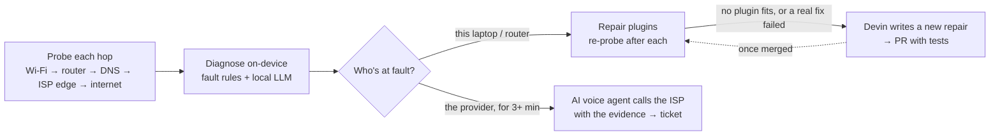

# Uplink

**Your network's advocate.** When the internet breaks, Uplink finds where it broke, explains it in plain
English with a model running on your laptop, tries the fixes on your side — and when it's your provider's
fault, **it phones their support line for you**, argues with the evidence, and comes back with a ticket.

Built at the Devin Hackathon, Hackerhouse @ GT, 2026-10-24.

## Why

When the internet goes down you lose the tools you'd use to fix it: no search, no chat support, no cloud AI.
You end up rebooting the router, then waiting on hold to tell a script reader what you already know.
Uplink does both jobs, and everything up to the phone call works **with no internet at all**.

## What it does



| Step | How | Needs internet? |
|---|---|---|
| Watch | 5 hops (Wi-Fi, router, DNS, ISP edge, internet) checked with 6 probes every 1.5 s while healthy; a fault must hold for 4 s before it counts, so a blip never becomes an incident — macOS `networksetup`/`ipconfig`, `route`, `ping`, `traceroute`, plus a DNS lookup and an HTTPS request from Node | No |
| Diagnose | Ordered fault rules → `{fault, blame, confidence, evidence}`; a **local** Llama 3.2 3B (Ollama) explains it in plain English | No |
| Fix | Repair plugins — flush DNS, switch resolver, renew DHCP, reconnect Wi-Fi (router reboot is simulated: there's no router API) — re-probing after each. They rehearse by default; see configuration | No |
| Call the provider | Once a provider outage has lasted 3 minutes, a Vapi voice agent on a Twilio number calls support with the account and the evidence, pushes back, and gets a ticket / credit / technician window | Yes — over a phone hotspot when the ISP is down |
| Learn | A fault the playbook can't handle goes to **Devin**, which writes a repair plugin + tests and opens a PR. Offline, the request is queued and sent when a connection is back | When available |

## Devin, twice

**Devin built it.** Five Devin cloud sessions ran in parallel, one slice each — monitor + diagnosis, repair
plugins, the call agent, the dashboard, and the Devin runtime client — against one shared contract
(`src/lib/types.ts`), with rules in `AGENTS.md` and a brief per session. Their commits (authored as
`omadjitov1`, the git identity on the Devin machines, each co-authored by Devin AI) plus the repair Devin
opened at runtime are 4,796 of the 6,596 lines committed here (~73%; lockfile and scaffold excluded).

**Devin is inside it.** When Uplink meets a fault its playbook can't fix, it calls the Devin API with the
probe evidence — plus the local model's explanation once it's ready, and any fixes that really ran and failed.
Devin writes the repair and opens a PR, and the dashboard follows the session live. Example:
[#1 · repair: ipv6 blackhole](https://github.com/workoholyguy/sentinel/pull/1) — from the dashboard's
simulated IPv6-blackhole fault, Devin wrote a 187-line plugin with 10 tests and opened the PR about
2½ minutes after Uplink sent the report. It's merged into `main`; Uplink loads it at runtime on Node 22.18+.

## Run it (macOS)

```bash
pnpm install
pnpm sentinel   # starts Uplink and opens it as its own Chrome/Edge/Brave/Arc app window
```

Needs [Ollama](https://ollama.com) with `llama3.2:3b` for the on-device explanations. Add `FULLSCREEN=1` for a
full-screen window. The dashboard's demo buttons inject a **simulated** fault (labelled on screen) and run the
real pipeline on it: **Simulate ISP outage** (→ the call) and **Unknown fault** (→ Devin writes the fix).

### Configuration (`.env.local`)

| Variable | What it switches |
|---|---|
| `VAPI_API_KEY`, `VAPI_PHONE_NUMBER_ID`, `SENTINEL_SUPPORT_NUMBER` | Real phone calls (all three needed; otherwise a scripted call) |
| `SENTINEL_CALL_AFTER_SECONDS` | How long a real provider outage must last before Uplink calls (default 180; simulated outages call at once) |
| `DEVIN_API_KEY`, `DEVIN_ORG_ID` | Real Devin repair sessions (`DEVIN_MOCK=1` for a 30 s simulated one) |
| `DEVIN_MAX_ACU`, `SENTINEL_REPO` | Spend cap per Devin session (default 8); repo Devin opens PRs on |
| `SENTINEL_DRY_RUN=0`, `SENTINEL_SUDO=1` | Let repair plugins change the system; run them via passwordless `sudo -n` (DNS flush and DHCP renew need root) |
| `LOCAL_LLM_URL`, `LOCAL_LLM_MODEL` | Any OpenAI-compatible local model (default Ollama, `llama3.2:3b`) |

## Honest limits

- Repair plugins **rehearse** by default; router reboot is simulated.
- The call and Devin need *some* way out when the ISP is fully down (e.g. a phone hotspot) — Uplink doesn't
  switch to a backup uplink by itself yet.
- The diagnosis rules don't detect an IPv6 blackhole on a real network yet; the Devin demo injects that fault.
- Runtime-loaded `.ts` repair plugins need Node 22.18+ (native TypeScript); on Node 20 they're skipped.
- The call transcript appears when the call ends (live streaming needs a public webhook).

## Stack

Next.js 15 · React 19 · TypeScript · Tailwind v4 · framer-motion · Ollama (Llama 3.2 3B) · Vapi · Twilio ·
Devin API · Vitest (170 tests).
