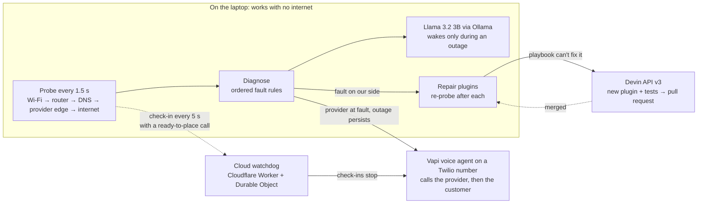

# Uplink

**When your internet dies, Uplink diagnoses it on-device, fixes what it can, and calls your provider for you.**

[Live dashboard](https://sentinel-ten-eosin.vercel.app/) · [Hackathon project](https://www.gthackerhouse.com/events/devin-hackathon/projects/12161ff8-cc0d-4fb4-8901-a74731f61fe6) · [Devin PR #1](https://github.com/workoholyguy/sentinel/pull/1)

Built in one day at the Devin Hackathon, Hackerhouse @ GT (Georgia Tech, Atlanta), Saturday Oct 24, 2026, by
Omar Madjitov. Hussain played the customer in the live demo and made the demo video. The project was renamed
from "Sentinel", which is why the repo is `workoholyguy/sentinel`.

> The hosted link is the dashboard UI only. The real product runs on your laptop, because it has to probe
> your own network.

## The problem

When the internet goes down you lose the tools you'd use to fix it: no search, no chat support, no cloud AI.
You reboot the router, then wait on hold to tell a script reader what you already know.

## What it does

1. **Watches each hop** (Wi-Fi, router, DNS, the provider's edge, the internet) every 1.5 s.
2. **Diagnoses the fault on the laptop.** A local Llama 3.2 3B model (Ollama) wakes only during an outage,
   explains it in plain English, then unloads.
3. **Fixes what's on your side** with repair plugins (flush DNS, switch resolver, renew DHCP, reconnect
   Wi-Fi), re-probing after each. They rehearse by default and apply only with opt-in admin rights.
4. **Calls your provider** when the provider is at fault and the outage persists (3 min by default; 8 s in
   the demo). An AI voice agent (Vapi, GPT-4o, on a real Twilio number) phones support with your account
   details and the evidence, pushes back when the rep blames your router, and comes back with a ticket
   number, the cause, an ETA, a credit, and anything you must do (e.g. pay a bill).
5. **Calls you back** with that update, only when there is news.

Both voice calls wait for the person who picks up to speak first.

## Works with no internet

Everything up to the phone call runs on the laptop. For the call itself, a **cloud watchdog** (a Cloudflare
Worker + Durable Object, in [`watchdog/`](watchdog)) stands by:

- The laptop checks in every 5 s, carrying a ready-to-place call with the latest evidence.
- If check-ins stop (20 s on stage, 60 s by default), the cloud places the provider call itself, follows it,
  and phones the customer when it ends with news, all while the house is still offline.
- When the laptop is back online, its next check-in tells it about both calls and it follows them instead
  of calling again.

**Exactly one side ever dials the customer.** The cloud claims the customer call before dialing, and the
laptop takes over only after the cloud confirms it stood down.

## How we used Devin

**Devin built it.** Omar wrote one shared typed contract ([`src/lib/types.ts`](src/lib/types.ts)) and the
rules in [`AGENTS.md`](AGENTS.md), then ran five Devin sessions in parallel, one slice each:

| Slice | What | Code |
|---|---|---|
| A | Network monitor + diagnosis | `src/lib/monitor/`, `src/lib/diagnose/` |
| B | Repair plugins | `src/lib/fixes/` |
| C | Voice-call agent | `src/lib/call/` |
| D | Mission-control dashboard | `src/components/`, `src/app/` |
| E | Devin runtime client | `src/lib/devin/` |

Together with the repair Devin opened at runtime, Devin's commits were about **73% of the code at
submission (4,796 of 6,596 lines)**.

**Devin runs inside it.** A fault the playbook can't handle goes to the Devin API (v3) with the evidence.
Devin writes a new repair plugin with tests and opens a pull request.

- [PR #1](https://github.com/workoholyguy/sentinel/pull/1): IPv6 black hole, 10 tests, opened about
  2½ minutes after the fault. Merged.
- [PR #2](https://github.com/workoholyguy/sentinel/pull/2): path-MTU black hole (slow HTTPS behind a
  healthy ping), from a real fault on the team's hotspot.

With no internet, the request queues and goes out once a connection returns. A 6-hour guard stops repeat
sessions for a chronic fault, and each session has an ACU cap.

## Measured in a real rehearsal

Real firewall outage, real phones:

| Moment | Time |
|---|---|
| Diagnosed on the laptop | 13 s after the outage |
| Provider's phone rang (placed by the cloud, laptop offline) | 18 s after the outage |
| Customer's phone rang (house still offline) | 7 s after the provider call ended |
| Duplicate calls | 0 |

## Architecture



The orchestrator loop is [`src/lib/sentinel.ts`](src/lib/sentinel.ts); the dashboard reads its state from
`GET /api/status`.

## Run it locally

**Prerequisites:** Node 20+ (22.18+ to load Devin-written `.plugin.ts` repairs at runtime), pnpm,
[Ollama](https://ollama.com) with `llama3.2:3b`, and macOS for the outage switch and the native app.

```bash
ollama pull llama3.2:3b
pnpm install
pnpm dev --port 3500        # dashboard at http://localhost:3500
```

`pnpm uplink` starts the same server on port 3500 (if it isn't running) and opens it as its own
Chrome/Edge/Chromium/Brave/Arc app window; add `FULLSCREEN=1` for full screen.

**macOS app** (Swift/AppKit: a window around the dashboard plus a status dot in the menu bar):

```bash
pnpm app    # runs mac/build.sh: needs swiftc (Xcode command line tools)
```

It builds `mac/build/Uplink.app`, copies it to `~/Applications/Uplink.app` and opens it. The app starts
`pnpm dev --port 3500` in this repo itself; closing the window keeps it watching from the menu bar.
`UPLINK_URL` points it at a different server.

### Configuration (`.env.local`)

Every variable is optional. With none set, Uplink still runs: calls fall back to a scripted mock, Devin and
the cloud watchdog stay off.

| Variable | Purpose |
|---|---|
| `VAPI_API_KEY` | Vapi private key. With the next two, enables real phone calls |
| `VAPI_PHONE_NUMBER_ID` | The Vapi (Twilio) number calls are placed from |
| `SENTINEL_SUPPORT_NUMBER` | Number dialed as the provider's support line (E.164) |
| `SENTINEL_CUSTOMER_NUMBER` | Customer's phone for the follow-up call (E.164); unset means no follow-up call |
| `SENTINEL_CUSTOMER_NAME` | Customer name the agent uses |
| `SENTINEL_CALLBACK_NUMBER` | Callback number the agent gives the provider |
| `SENTINEL_CALL_AFTER_SECONDS` | How long a real provider outage lasts before the call (default 180) |
| `SENTINEL_DEMO_CALL_AFTER_SECONDS` | The same for simulated demo faults (default 10) |
| `WATCHDOG_URL`, `WATCHDOG_TOKEN` | Cloud watchdog address and shared bearer token; both set turns it on |
| `WATCHDOG_QUIET_SECONDS` | Silence before the cloud calls (default 60, minimum 10) |
| `DEVIN_API_KEY` | Devin service-user key; enables runtime repair sessions |
| `DEVIN_ORG_ID` | Devin organization for those sessions |
| `DEVIN_API_BASE` | Devin API base URL (default `https://api.devin.ai`) |
| `DEVIN_MAX_ACU` | ACU cap per Devin session (default 8) |
| `DEVIN_MOCK` | `1` simulates a Devin session without calling the API |
| `SENTINEL_REPO` | Repo Devin opens pull requests on (default this one) |
| `SENTINEL_DRY_RUN` | `0` lets repair plugins change the system (default: rehearse only) |
| `SENTINEL_SUDO` | `1` runs repair commands through passwordless `sudo -n` (DNS flush and DHCP renew need root) |
| `SENTINEL_DEMO` | `1` lets the router-reboot plugin simulate a reboot outside a dry run (there's no router API) |
| `LOCAL_LLM_URL` | OpenAI-compatible endpoint of the local model (default Ollama on `127.0.0.1:11434`) |
| `LOCAL_LLM_MODEL` | Local model name (default `llama3.2:3b`) |
| `UPLINK_CALLING_FILE` | Where the calling switch is saved (default `.uplink-calling` in the repo) |

### Deploy the cloud watchdog

The Worker reads two secrets: `VAPI_API_KEY` and `WATCHDOG_TOKEN` (any long random string, the same value as
in `.env.local`). The Durable Object binding `WATCHDOG` is declared in `watchdog/wrangler.toml`.

```bash
cd watchdog
npx wrangler deploy
npx wrangler secret put VAPI_API_KEY
npx wrangler secret put WATCHDOG_TOKEN
```

Then set `WATCHDOG_URL` (the `workers.dev` URL wrangler prints) and `WATCHDOG_TOKEN` in `.env.local`.
`GET /status` on the Worker, with the same bearer token, shows what the cloud is doing. Before closing the
laptop, `pnpm watchdog:off` disarms it so it doesn't call while Uplink is stopped.

## Demo controls

| Control | What it does |
|---|---|
| **Imitate outage** (dashboard) | A real outage: the macOS `pf` firewall blocks everything past the router while the router still answers. Click again to end it. |
| **Calling on / off** (dashboard) | Off: no phone rings, calls fall back to a scripted mock and the cloud is disarmed. Saved across restarts. |
| Keys `1` / `2` / `0` (dashboard) | Simulated ISP outage · unknown fault (handed to Devin) · restore |
| `pnpm outage:on` / `pnpm outage:off` | The same real outage from a terminal (asks for your password) |

The outage switch runs `pfctl` through `sudo -n`. The first time, the dashboard shows the one-line sudoers
rule to paste into a terminal.

The macOS app's **Demo** menu: Imitate outage (real) `⌘3`, End outage `⌘4`, Simulate ISP outage `⌘1`,
Unknown fault (Devin) `⌘2`, Restore `⌘0`. The menu-bar dot offers the simulated faults too.

## Project layout

| Path | What's there |
|---|---|
| `src/app/` | Next.js App Router page and API routes (`/api/status`, `/api/demo/*`) |
| `src/components/dashboard/` | Mission-control dashboard |
| `src/lib/` | Monitor, diagnosis, repair plugins, call agent, Devin client, orchestrator loop, shared types |
| `watchdog/` | Cloud watchdog: Cloudflare Worker + Durable Object, deployed with wrangler |
| `mac/` | Native macOS app (Swift/AppKit + WKWebView) and its build script |
| `scripts/` | App-window launcher, real-outage script, watchdog disarm |
| `AGENTS.md` | The rules every Devin session followed |

## Tests

```bash
pnpm test        # Vitest: 206 tests, no network calls
pnpm typecheck
pnpm lint
pnpm build
```

## Stack

Next.js 15 (App Router) · TypeScript · Tailwind CSS v4 · framer-motion · lucide-react · Vitest · Ollama +
Llama 3.2 3B · Vapi + Twilio · Cloudflare Workers + Durable Objects (wrangler) · Devin API v3 · Swift/AppKit +
WKWebView · macOS `pf` firewall

## Credits

Omar Madjitov: architect, integrator and PM. Wrote the shared contract, ran and integrated the five Devin
sessions, built the orchestrator loop, the outage switch, the cloud watchdog integration and the macOS app, and
ran the live demo. Hussain played the customer in the live demo and made the demo video.
